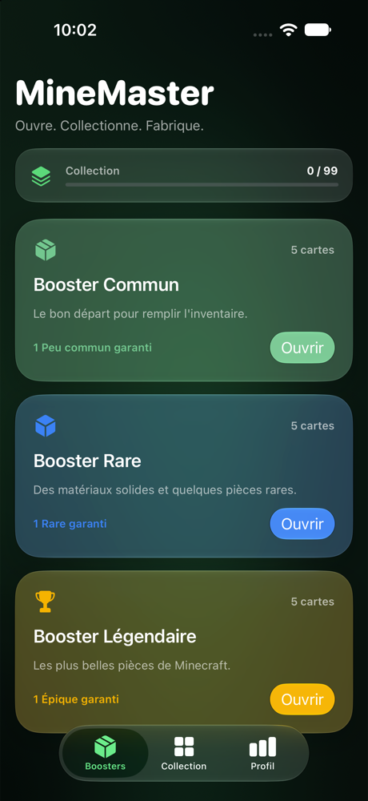
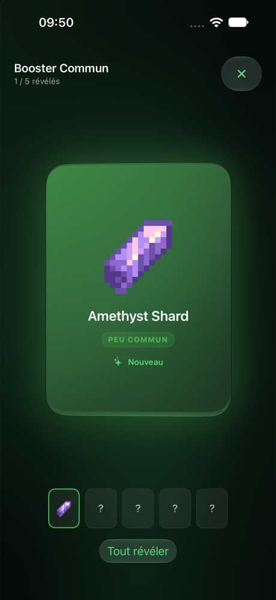

# MineMaster

Application iOS native de collection : ouvre des boosters, découvre des items Minecraft, complète ta collection et fabrique les pièces manquantes avec la poussière gagnée sur les doublons.

| Boosters | Ouverture | Collection | Profil |
|---|---|---|---|
|  |  |  |  |

## Stack

- Swift 6 (mode langage complet, concurrence stricte, isolation `MainActor` par défaut)
- SwiftUI + Liquid Glass natif (`glassEffect`, `GlassEffectContainer`, `.buttonStyle(.glass)`, `tabBarMinimizeBehavior`, transitions zoom)
- SwiftData pour le catalogue, la collection et l'historique
- `URLSession` + pipeline d'images maison (aucune dépendance tierce)
- Cible : iOS 27.2, Xcode 27.2

## Lancer le projet

```bash
open MineMaster.xcodeproj
```

Sélectionne un simulateur iPhone, puis `⌘R`. Aucune clé d'API ni configuration n'est nécessaire.

Build en ligne de commande :

```bash
xcodebuild -project MineMaster.xcodeproj -scheme MineMaster \
  -destination 'generic/platform=iOS Simulator' build
```

## Fonctionnalités

- 3 boosters (Commun, Rare, Légendaire), 5 cartes par ouverture, garanties par rareté
- 5 raretés, 6 catégories, 99 items
- Révélation animée carte par carte, option « Tout révéler », haptiques
- Collection avec recherche, filtres rareté/catégorie et filtre « possédés »
- Fiche détail avec transition zoom
- Doublons convertis en poussière, fabrication d'items manquants
- Statistiques locales, réinitialisation, mentions légales
- Skeletons de chargement, mode hors ligne avec catalogue en cache
- Accessibilité : VoiceOver, Dynamic Type, Reduce Motion

## Sources de données

| Usage | Source |
|---|---|
| Métadonnées | `PrismarineJS/minecraft-data` (1.21.4) |
| Textures | jsDelivr, miroir `InventivetalentDev/minecraft-assets` (1.21.4) |
| Repli | `MineMaster/Resources/ItemCatalog.json` (embarqué) |

La version d'assets est figée. Aucune requête n'est faite vers un hôte hors allowlist, aucun secret n'est présent dans le binaire.

## Architecture

```text
MineMaster/
├─ App/            point d'entrée, onglets
├─ Domain/         modèles, règles de tirage
├─ Data/           API, SwiftData, GameStore, pipeline d'images
├─ Design/         thème, composants, skeletons
├─ Features/       boosters, ouverture, collection, profil
└─ Resources/      catalogue embarqué, manifeste de confidentialité
```

- `GameStore` centralise l'état observable et les règles métier.
- `LootEngine` est pur et testable (générateur aléatoire injecté).
- `ImagePipeline` coalesce les requêtes, valide les réponses (MIME, taille), met en cache mémoire et disque.
- Le catalogue distant est fusionné avec les définitions locales, puis persisté.

## Sécurité et vie privée

- HTTPS uniquement, ATS par défaut, aucune exception
- Allowlist d'hôtes et validation des chemins d'images
- Payloads bornés (5 Mo métadonnées, 2 Mo images)
- Aucune collecte, aucun tracking, aucun SDK tiers
- `PrivacyInfo.xcprivacy` fourni
- SVG embarqués uniquement (Heroicons)

## Limites connues

- Pas de compte ni de synchronisation : la progression est locale
- Économie non sécurisée côté serveur (projet pédagogique)
- Français uniquement pour l'instant, chaînes prêtes pour un String Catalog
- Pas encore de cible de tests automatisés

## Licences

- Heroicons 2.2.0, MIT, © Tailwind Labs
- Textures et noms Minecraft, © Mojang Studios / Microsoft — projet non commercial et non affilié, assets non redistribués
- SF Symbols, Apple

Le cahier des charges complet est disponible dans [`docs/CAHIER_DES_CHARGES.md`](docs/CAHIER_DES_CHARGES.md).
