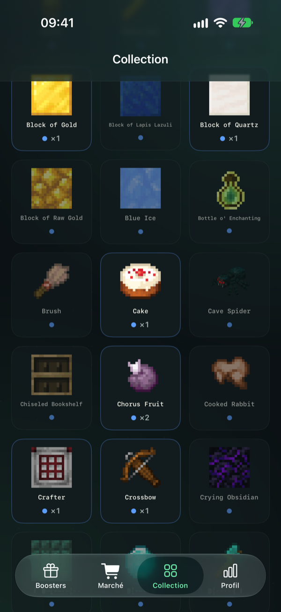

# MineMaster

<<<<<<< HEAD


=======


>>>>>>> 12d95e8 (docs: utiliser les badges du repo ileriayo/markdown-badges (style flat avec logos))


Application iOS éducative de collection : ouvre des packs, découvre des items Minecraft et complète ta collection. La poussière gagnée sur les doublons servira plus tard.

Projet non commercial, libre de droits. Tout le monde peut le réutiliser.

## Aperçu (iOS)

| Boosters | Ouverture | Collection | Profil |
|---|---|---|---|
|  |  |  |  |

*Les captures seront rafraîchies prochainement.*

## Apple Watch

La cible `MineMasterWatch` est un miroir compact de l'iPhone, avec son schéma et ses tests. L'iPhone reste l'unique source de vérité : la montre lui envoie chaque action et applique l'état reçu. Hors connexion, elle reste en lecture seule sur le dernier état synchronisé, et une déconnexion verrouille son cache.

- Ouverture de packs, collection, marché dédié, profil et renaissance
- Statistiques communautaires par item
- Complication WidgetKit : progression, poussière, titre courant et prochain titre
- Aucun second compte : la montre ne crée jamais de progression locale

Les fichiers partagés vivent dans `Shared/` et `SharedComplication/` et sont référencés explicitement par les cibles iOS, watchOS et WidgetKit.

## Fonctionnalités

### Compte et synchronisation
- Connexion obligatoire : email/mot de passe ou Google Sign-In (une fois configuré dans la console Firebase)
- Progression synchronisée par compte sur Firestore
- Démarrage non bloquant derrière un écran de chargement en skeleton

### Ouverture de boosters
- Pack mystère unique : rareté et type tirés avant l'ouverture, type affiché sur le pack scellé
- 5 cartes par pack, garanties par rareté
- Révélation en carrousel avec effets visuels pour les cartes rares, épiques et légendaires
- Types de packs : créatures, armes, armures, consommables, nourriture, blocs, outils

### Collection
- 515 items répartis en 8 catégories et 5 raretés (blocs, outils, armes, armures, livres enchantés, créatures, objets historiques retirés du jeu)
- Recherche, filtres rareté/catégorie et filtre « possédés »
- Fiche détail en modal : chance de tirage, tirages locaux et mondiaux, prix du marché

### Marché et poussière
- Achat et revente d'items contre de la poussière
- Les doublons se convertissent en poussière

### Renaissance
- Boosts permanents de rareté et de poussière, cumulables sans plafond
- Vide la collection et la poussière, conserve l'historique et incrémente le niveau

### Profil et statistiques
- Anneau de progression, répartitions par catégorie et rareté
- Sept titres d'explorateur expliqués en modal
- Statistiques locales et communautaires (tirages et échanges mondiaux)
- Tutoriel de premier lancement en trois étapes

## Stack technique

- **Swift 6** — concurrence stricte, isolation `MainActor` par défaut
- **SwiftUI** — Liquid Glass natif (`glassEffect`, `GlassEffectContainer`, `.buttonStyle(.glass)`, transitions zoom)
- **SwiftData** — catalogue, collection et historique
- **URLSession** — pipeline d'images maison avec cache mémoire et disque
- **Firebase** — `FirebaseCore`, `FirebaseAuth`, `FirebaseFirestore` et `GoogleSignIn` via Swift Package Manager
- Cibles : iOS 26.0 et watchOS 26.0, Xcode 26.0 ou plus récent (projet au format `project.pbxproj`)

## Lancer le projet

```bash
open MineMaster.xcodeproj
```

Sélectionne un simulateur iPhone, puis `⌘R`. Le fichier `GoogleService-Info.plist` est déjà embarqué. Les fournisseurs (email, Google) et Firestore se configurent dans la console : voir [`docs/FIREBASE.md`](docs/FIREBASE.md).

Build en ligne de commande :

```bash
xcodebuild -project MineMaster.xcodeproj -scheme MineMaster \
  -destination 'generic/platform=iOS Simulator' build
```

Cible Apple Watch :

```bash
xcodebuild -project MineMaster.xcodeproj -scheme MineMasterWatch \
  -destination 'generic/platform=watchOS' build
```

## Tests

- `MineMasterTests` : tests unitaires Swift Testing, conteneur SwiftData en mémoire, sessions réseau de test.
- `MineMasterUITests` : parcours XCTest pilotés par l'interface, aucun accès réseau.
- `MineMasterWatchTests` : protocole WatchConnectivity, bornes d'état et lien local déterministe.
- `MineMasterWatchUITests` : navigation, marché et ouverture sur watchOS.

```bash
xcodebuild test -project MineMaster.xcodeproj -scheme MineMaster \
  -destination 'platform=iOS Simulator,name=<simulateur installé>'

xcodebuild test -project MineMaster.xcodeproj -scheme MineMasterWatch \
  -destination 'platform=watchOS Simulator,name=<montre installée>'
```

Les conventions et invariants sont décrits dans [`AGENTS.md`](AGENTS.md).

## Contributeurs

Projet fait en équipe par :

- **Abigaïl Kettab-Code**
- **Noah Cleon**
- **Axel Lalaut**

Tous ont travaillé sur le projet, même si seuls certains apparaissent comme contributeurs sur GitHub. Merci à tou·te·s.

## Licence

Ce projet est sous licence [MIT](LICENSE). C'est un projet éducatif et non commercial : tu es libre de le réutiliser, de le modifier et de le partager.

Les assets Minecraft (textures, noms, rendus de créatures) restent la propriété de Mojang Studios / Microsoft et de Minecraft Wiki. Ils ne sont pas redistribués et ne constituent pas une affiliation officielle.

## Soutenez le projet

Si MineMaster te plaît, pense à mettre une ⭐ sur le dépôt. Ça aide beaucoup et ça fait toujours plaisir.

Le cahier des charges complet est disponible dans [`docs/CAHIER_DES_CHARGES.md`](docs/CAHIER_DES_CHARGES.md).
