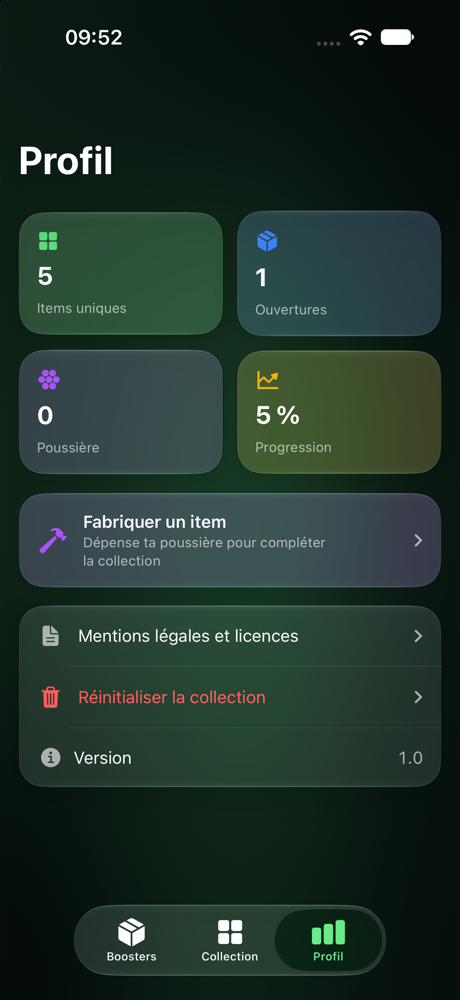

#  MineMaster

[](https://www.swift.org/)
[](https://developer.apple.com/xcode/swiftui/)
[](https://developer.apple.com/ios/)
[](https://developer.apple.com/watchos/)
[](https://firebase.google.com/)

[](https://github.com/Axxel-L/MineMaster)

**Ouvre des packs, collectionne 515 items Minecraft, échange-les sur le marché et renais pour améliorer tes tirages.**

Application iOS et Apple Watch, éducative et non commerciale. La montre est autonome : elle joue sur sa propre progression, sans compte ni réseau.

---

##  Navigation rapide

| Je veux… | Section |
|---|---|
|  Voir le jeu | [Aperçu](#apercu) |
|  Comprendre les fonctionnalités | [Fonctionnalités](#fonctionnalites) |
|  Lancer l'application | [Démarrage](#demarrage) |
|  Lancer les tests | [Tests](#tests) |
|  Voir les widgets | [Widgets iPhone](#widgets-iphone) |
|  Voir la montre | [Apple Watch](#apple-watch) |
|  Voir la stack | [Stack technique](#stack-technique) |
|  Explorer le code | [Architecture](#architecture) |
|  Lire la documentation | [Documentation](#documentation) |
|  Contribuer | [Contribuer](#contribuer) |
|  Résoudre un problème | [FAQ](#faq) |
|  Voir la licence | [Licence](#licence) |

---

<a id="apercu"></a>
##  Aperçu

| Boosters | Ouverture | Collection | Profil |
|---|---|---|---|
|  |  |  |  |

|  515 items |  8 catégories |  5 raretés |  iOS + watchOS |
|:---:|:---:|:---:|:---:|

---

<a id="fonctionnalites"></a>
##  Fonctionnalités

<details open>
<summary> <strong>Ouverture des boosters</strong></summary>

- Un **Pack Mystère** unique : la rareté du booster et le type de contenu sont tirés avant l'ouverture.
- Le pack scellé affiche le type exact qui sera ouvert.
- **5 cartes par pack**, sans doublon dans le paquet.
- Rareté minimale garantie : peu commun pour un booster commun, rare pour un rare, épique pour un légendaire.
- Révélation carte par carte : **un premier appui révèle la carte**, un second appui passe à la suivante non révélée. Le glissement reste possible.
- Effets visuels et haptiques pour les cartes rares, épiques et légendaires.
- Verrou d'ouverture : un seul booster peut être ouvert à la fois.
- Types de contenu : mélangé, créatures, armes, armures, consommables, nourriture, blocs et outils.

</details>

<details>
<summary> <strong>Collection, poussière et marché</strong></summary>

- **515 items** répartis en 8 catégories : blocs, outils, armes, armures, nourriture, matériaux, créatures et objets spéciaux.
- Recherche, filtres par rareté et par catégorie, filtre « possédés ».
- Fiche détail avec chance de tirage, tirages locaux et mondiaux, prix du marché.
- La **poussière** se gagne sur les doublons et sert à acheter des items.
- Achat et revente avec stock limité, prix dérivés de la rareté et compteurs persistés.
- Aucun stock négatif, aucune poussière négative.

| Rareté | Poussière par doublon |
|---|---:|
| Commun | 2 |
| Peu commun | 4 |
| Rare | 8 |
| Épique | 20 |
| Légendaire | 50 |

</details>

<details>
<summary> <strong>Renaissance et progression</strong></summary>

- Renaissance disponible à partir de **25 items uniques**.
- La renaissance vide la collection et la poussière, conserve l'historique des ouvertures et incrémente le niveau d'un palier.
- Les boosts de rareté et de poussière sont permanents, cumulables et sans plafond.
- Le stock du marché revient à 1 après une renaissance.
- Anneau de progression, répartition par catégorie et par rareté.
- **7 titres d'explorateur** : Novice, Explorateur, Prospecteur, Collectionneur, Artisan, Légende et Maître du monde.

</details>

<details>
<summary> <strong>Compte et synchronisation</strong></summary>

- Connexion obligatoire sur iPhone : email/mot de passe ou Google Sign-In, une fois le fournisseur configuré dans Firebase.
- Chaque compte Firebase possède son propre magasin SwiftData : deux comptes ne partagent jamais collection, poussière ou stock.
- Progression synchronisée sur Firestore avec résolution des conflits : une modification locale en attente gagne sur la copie distante.
- Aucune écriture distante avant une lecture réussie du document Firestore.
- Statistiques mondiales agrégées par item, bornées et purement indicatives.
- Aucun accès à la progression sans session authentifiée.

</details>

<details>
<summary> <strong>Profil et tutoriel</strong></summary>

- Statistiques personnelles et communautaires : tirages, échanges, catégories et raretés.
- Prochain titre et seuil restant affichés dans le profil.
- Tutoriel de premier lancement en trois étapes, refermable avec « Passer ».
- Écran légal et informations sur les assets.

</details>

<details>
<summary> <strong>Widgets iPhone</strong></summary>

- **Progression** : anneau de collection, items uniques, poussière et échelle de titres.
- **Carrière** : titre courant, ouvertures et renaissances.
- **Pack** : accès rapide à l'écran Boosters pour ouvrir un booster.
- Formats petit et moyen, lecture seule, aucun identifiant de compte partagé.
- Un appui ouvre l'onglet correspondant ; le widget n'écrit jamais dans la progression.
- Sans connexion, un placeholder invite à ouvrir l'application.

</details>

---

<a id="widgets-iphone"></a>
##  Widgets iPhone

La cible `MineMasterWidgets` est une extension WidgetKit séparée. Elle lit un
état borné écrit par l'application dans le groupe d'applications
`group.com.minemaster.iut-st-die`.

- Trois widgets : progression, carrière et accès rapide au pack.
- Les données se limitent à la progression, aux compteurs, au titre et à la
  poussière. Aucun email, aucun identifiant Firebase, aucune collection brute.
- Le widget est en lecture seule : il ouvre l'application via `minemaster://`
  et ne modifie jamais la progression.
- L'état est réécrit après chaque action locale et effacé à la déconnexion.
- La capacité **App Groups** doit être autorisée pour la cible iOS et la cible
  `MineMasterWidgets`. Sans elle, le widget affiche son placeholder.

---

<a id="apple-watch"></a>
##  Apple Watch

La cible `MineMasterWatch` est **autonome** : elle charge le catalogue embarqué et joue sur son propre magasin SwiftData.

- Ouverture de packs, collection, marché, profil, renaissance et tutoriel.
- Aucun compte, aucun Firebase, aucun réseau.
- Tirages locaux par item ; les compteurs communautaires ne sont pas disponibles sur la montre.
- La progression de la montre et celle de l'iPhone divergent par conception.
- Complication WidgetKit : progression, poussière, titre courant et prochain titre.
- La complication partage un état borné via App Groups, sans progression brute ni identifiant de compte.
- Le code de miroir WatchConnectivity reste disponible, mais l'application livrée utilise le mode local.

---

<a id="stack-technique"></a>
##  Stack technique

| Domaine | Choix |
|---|---|
| Langage | **Swift 6**, concurrence stricte, isolation `MainActor` par défaut |
| Interface | **SwiftUI**, Liquid Glass natif (`glassEffect`, `GlassEffectContainer`, boutons glass) |
| Données locales | **SwiftData**, un conteneur par compte |
| Réseau | `URLSession` avec pipeline d'images, cache mémoire et disque |
| Authentification et cloud | **Firebase** : `FirebaseCore`, `FirebaseAuth`, `FirebaseFirestore`, `GoogleSignIn` |
| Cibles | iOS 26.0, watchOS 26.0, WidgetKit |
| Outils | Xcode 26 ou plus récent, Swift Package Manager |

Dépendances tierces autorisées : Firebase et Google Sign-In uniquement.

---

<a id="architecture"></a>
##  Architecture

<details>
<summary><strong>Afficher l'arborescence du dépôt</strong></summary>

```text
MineMaster/
├─ MineMaster/                 Application iOS
│  ├─ App/                     Entrée, authentification, navigation, tutoriel
│  ├─ Data/                    SwiftData, Firestore, catalogue, images
│  ├─ Domain/                  Modèles, tirages, marché, renaissance, titres
│  ├─ Design/                  Thème, packs, animations, composants visuels
│  └─ Features/                Boosters, ouverture, collection, marché, profil
├─ MineMasterWidgets/          Widgets iPhone WidgetKit
├─ MineMasterWatch/            Application watchOS autonome
├─ MineMasterWatchWidgets/     Complication WidgetKit
├─ Shared/                     Protocole montre, relais WCSession, révélation et état borné partagé
├─ MineMasterTests/            Tests unitaires Swift Testing
├─ MineMasterUITests/          Parcours d'interface XCTest
├─ MineMasterWatchTests/       Tests unitaires watchOS
├─ MineMasterWatchUITests/     Parcours d'interface watchOS
├─ docs/                       Cahier des charges, design, Firebase, captures
├─ firebase/                   Règles Firestore
└─ MineMaster.xcodeproj        Projet Xcode
```

</details>

<details>
<summary><strong>Invariants importants</strong></summary>

- Une ouverture à la fois, cinq cartes, aucune rareté à multiplicateur zéro.
- La poussière est comptée une seule fois par doublon.
- Le stock et la poussière ne deviennent jamais négatifs.
- Chaque compte utilise son propre magasin local.
- La montre livrée ne modifie jamais la progression iPhone.
- Toute image distante est bornée, validée et mise en cache.
- Les règles Firestore n'autorisent que `players/{uid}` du compte connecté.

</details>

---

<a id="demarrage"></a>
##  Démarrage

**Prérequis :** macOS avec Xcode 26 ou plus récent, un simulateur iPhone, et un simulateur Apple Watch pour la cible watchOS.

1. Ouvre le projet :

   ```bash
   open MineMaster.xcodeproj
   ```

2. Sélectionne le schéma `MineMaster`, choisis un simulateur iPhone puis lance avec `⌘R`.
3. Le fichier `GoogleService-Info.plist` est déjà embarqué. Les fournisseurs Firebase et Firestore se configurent dans la console : voir [`docs/FIREBASE.md`](docs/FIREBASE.md).

Build en ligne de commande :

```bash
xcodebuild -project MineMaster.xcodeproj -scheme MineMaster \
  -destination 'generic/platform=iOS Simulator' build
```

Cible Apple Watch :

```bash
xcodebuild -project MineMaster.xcodeproj -scheme MineMasterWatch \
  -destination 'generic/platform=watchOS' build
```

> La complication, les widgets iPhone et le partage d'état nécessitent l'entitlement **App Groups** autorisé par l'équipe de signature. Sans lui, la complication et les widgets affichent un placeholder et le reste de l'application continue de fonctionner.

---

<a id="tests"></a>
##  Tests

| Cible | Rôle |
|---|---|
| `MineMasterTests` | Tests unitaires Swift Testing, SwiftData en mémoire, réseau simulé |
| `MineMasterUITests` | Parcours XCTest iOS, lancement déterministe avec `-uiTesting` |
| `MineMasterWatchTests` | Protocole montre, bornes d'état et lien local |
| `MineMasterWatchUITests` | Navigation, marché et ouverture sur watchOS |

```bash
xcodebuild test -project MineMaster.xcodeproj -scheme MineMaster \
  -destination 'platform=iOS Simulator,name=<simulateur installé>'

xcodebuild test -project MineMaster.xcodeproj -scheme MineMaster \
  -destination 'platform=iOS Simulator,name=<simulateur installé>' \
  -only-testing:MineMasterUITests

xcodebuild test -project MineMaster.xcodeproj -scheme MineMasterWatch \
  -destination 'platform=watchOS Simulator,name=<montre installée>'
```

Les tests utilisent un générateur aléatoire injecté, une session réseau de test et aucun `sleep`. Les conventions complètes et les invariants sont dans [`AGENTS.md`](AGENTS.md).

---

<a id="documentation"></a>
##  Documentation

| Document | Contenu |
|---|---|
| [`docs/CAHIER_DES_CHARGES.md`](docs/CAHIER_DES_CHARGES.md) | Règles de jeu, sécurité, données et invariants |
| [`docs/DESIGN_SYSTEM.md`](docs/DESIGN_SYSTEM.md) | Couleurs, typographie, espacements et composants |
| [`docs/FIREBASE.md`](docs/FIREBASE.md) | Auth, Firestore, configuration Google Sign-In |
| [`AGENTS.md`](AGENTS.md) | Règles de code, tests, Git et définition de terminé |

---

<a id="contribuer"></a>
##  Contribuer

<details>
<summary><strong>Règles de contribution</strong></summary>

- Lis [`AGENTS.md`](AGENTS.md) avant toute modification.
- Swift 6, concurrence stricte et isolation `MainActor` par défaut.
- Aucune dépendance tierce en dehors de Firebase et Google Sign-In.
- Toute modification de comportement ajoute ou met à jour un test.
- Commits conventionnels en français : `feat:`, `fix:`, `core:`, `test:`, `docs:`.
- Aucun secret, jeton ou donnée personnelle dans le code, les logs ou le dépôt.
- Ne commit jamais `xcuserdata`, `DerivedData` ou un dossier `build`.

</details>

Projet réalisé en équipe par **Abigaïl Kettab-Code**, **Noah Cleon** et **Axel Lalaut**. Merci à toutes les personnes qui ont contribué, même celles qui n'apparaissent pas dans la liste GitHub.

---

<a id="faq"></a>
##  FAQ

<details>
<summary><strong>Pourquoi la progression de la montre est différente de celle de l'iPhone ?</strong></summary>

La montre livrée utilise son propre magasin SwiftData. Elle est conçue pour jouer hors ligne, sans compte et sans Firebase. Les deux progressions divergent volontairement.

</details>

<details>
<summary><strong>Pourquoi « Continuer avec Google » est-il désactivé ?</strong></summary>

Le fournisseur Google doit être activé dans la console Firebase, avec le plist et l'URL scheme déclarés. La procédure est décrite dans [`docs/FIREBASE.md`](docs/FIREBASE.md).

</details>

<details>
<summary><strong>Pourquoi ma complication affiche-t-elle un placeholder ?</strong></summary>

L'entitlement App Groups doit être autorisé par l'équipe de signature. Sans lui, la montre et la complication ne peuvent pas partager leur état borné.

</details>

<details>
<summary><strong>Les images ne se chargent pas ?</strong></summary>

Les images passent par un CDN en HTTPS avec une allowlist d'hôtes. En mode `-uiTesting`, le réseau est coupé et un catalogue fixe remplace le catalogue de production.

</details>

---

<a id="licence"></a>
##  Licence

Projet sous licence [MIT](LICENSE). Projet éducatif et non commercial : réutilisation, modification et partage autorisés.

Les assets Minecraft (textures, noms, rendus de créatures) restent la propriété de Mojang Studios / Microsoft et de Minecraft Wiki. Ils ne sont pas redistribués et ne constituent pas une affiliation officielle.

---

<sub>Si MineMaster te plaît, une étoile sur le dépôt aide beaucoup.</sub>

[](https://github.com/Axxel-L/MineMaster)
