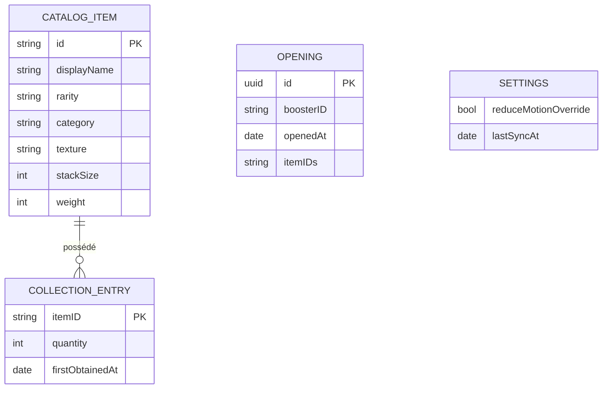
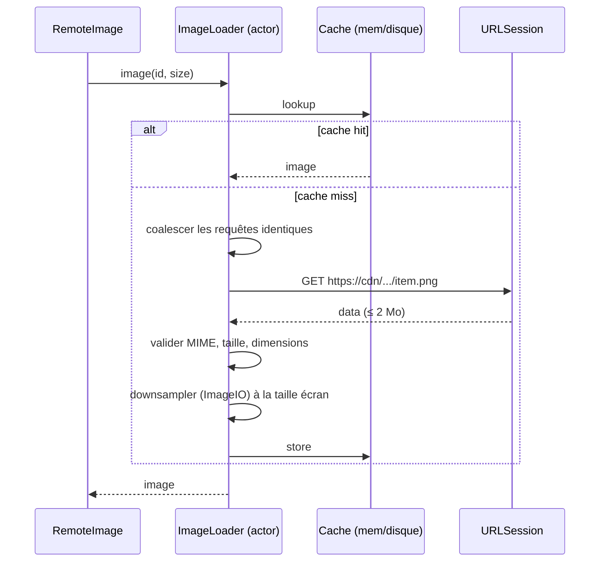

# Cahier des charges — MineMaster

| Champ | Valeur |
|---|---|
| Projet | MineMaster — ouverture de boosters Minecraft |
| Type | Application iOS native (SwiftUI) |
| Version du document | 1.0 |
| Date | 19/11/2026 |
| Auteur | Axel L. |
| Référence visuelle | [kyara.games](https://kyara.games/) (pack opening, révélation de cartes) |
| Cible technique | iOS 27.2 · Swift 6 · Xcode 27 |
| Statut | Validé pour développement MVP |

---

## 1. Contexte et objectif

MineMaster est une application iOS de collection qui reprend le principe d'ouverture de boosters de sites comme Kyara : l'utilisateur ouvre un paquet, découvre des cartes d'items Minecraft avec un niveau de rareté, puis complète sa collection.

Objectifs :

1. Démontrer une maîtrise des composants natifs iOS 26/27 (Liquid Glass, animations, concurrence Swift 6).
2. Consommer une API distante pour le catalogue et les visuels, avec un chargement progressif (skeleton loading).
3. Livrer un code compact, fluide et sécurisé, sans dépendance tierce.
4. Produire un dépôt GitHub présentable pour l'évaluation du cours.

### 1.1 Indicateurs de réussite

| Indicateur | Cible |
|---|---|
| Ouverture complète d'un booster | ≤ 12 s, sans blocage UI |
| Fluidité pendant la révélation | 60 fps constants (120 ProMotion) |
| Premier écran utile (hors images) | ≤ 1,5 s à froid |
| Fonctionnement hors ligne | Catalogue en cache, collection consultable |
| Avertissements compilateur | 0 (Swift 6, concurrence stricte) |
| Dépendances tierces d'exécution | 0 |

---

## 2. Périmètre

### 2.1 Inclus dans la v1 (MVP)

- Catalogue d'items Minecraft récupéré à distance, mis en cache, avec repli embarqué.
- Trois types de boosters avec tables de butin pondérées.
- Séquence d'ouverture animée (déchirure, révélation carte par carte, récapitulatif).
- Collection locale persistante (SwiftData) avec recherche et filtres.
- Fiche détail d'un item.
- Écran statistiques locales (ouvertures, raretés obtenues, progression).
- Skeletons de chargement, gestion d'erreur et mode hors ligne.
- Design Liquid Glass natif, accessibilité complète, FR uniquement.

### 2.2 Exclu de la v1

- Comptes, inscription, synchronisation cloud.
- Achat intégré, monnaie réelle, publicité, analytics.
- Multijoueur, échanges, marché.
- Notifications push.
- Version iPad/visionOS dédiée (l'app reste utilisable, sans mise en page spécifique).
- Anti-triche : la progression est locale et non fiable par conception.

> Ces exclusions sont assumées et documentées. L'architecture laisse des points d'extension (voir §8.5) sans les implémenter.

---

## 3. Personas et user stories

### 3.1 Personas

| Persona | Besoin |
|---|---|
| Joueur occasionnel | Ouvrir un booster rapidement, voir de belles cartes, retrouver sa collection. |
| Collectionneur | Connaître les raretés, la progression, les doublons, filtrer par type. |
| Évaluateur (professeur) | Comprendre l'architecture, la sécurité et la qualité du code en quelques minutes. |

### 3.2 User stories et critères d'acceptation

**US-01 — Ouvrir un booster**
En tant que joueur, je veux ouvrir un booster pour découvrir 5 items.
- Le tap sur « Ouvrir » déclenche un retour haptique puis l'animation, sans latence > 100 ms.
- Les 5 items sont tirés selon la table pondérée du booster.
- En cas d'échec réseau, les visuels manquants affichent un skeleton puis une icône de repli, sans bloquer la révélation.

**US-02 — Comprendre la rareté**
En tant que joueur, je veux identifier la rareté d'un item immédiatement.
- Chaque rareté a une couleur, un libellé textuel et un effet visuel distinct.
- L'information reste lisible sans couleur (accessibilité daltonisme).

**US-03 — Parcourir sa collection**
En tant que collectionneur, je veux voir tous mes items et leur quantité.
- Grille responsive, compteur global `possédés / total`.
- Recherche tolérante à la casse et filtres par rareté et catégorie.
- L'état vide propose d'ouvrir un booster.

**US-04 — Consulter un item**
En tant que joueur, je veux voir le détail d'un item.
- Transition zoom depuis la carte source.
- Affiche nom, rareté, catégorie, quantité possédée, chance d'obtention.

**US-05 — Jouer hors ligne**
En tant que joueur, je veux ouvrir l'app sans réseau.
- Le dernier catalogue synchronisé est utilisé.
- La collection et les statistiques restent consultables.
- Un bandeau discret signale le mode hors ligne ; aucune erreur bloquante.

**US-06 — Réinitialiser**
En tant que joueur, je veux effacer ma progression.
- Action dans Réglages, confirmation destructive explicite, irréversible.

---

## 4. Exigences fonctionnelles

| ID | Exigence | Priorité |
|---|---|---|
| EF-01 | Synchroniser le catalogue d'items au lancement (version d'assets figée). | Must |
| EF-02 | Persister le catalogue sur disque et embarquer un catalogue de secours. | Must |
| EF-03 | Afficher 3 boosters : Commun, Rare, Légendaire. | Must |
| EF-04 | Tirer 5 items par ouverture, pondérés par rareté, sans doublon exact dans un même paquet. | Must |
| EF-05 | Animer l'ouverture : déchirure, révélation séquentielle, possibilité de tout révéler. | Must |
| EF-06 | Enregistrer chaque item obtenu (quantité, date de première obtention). | Must |
| EF-07 | Afficher la collection en grille avec recherche et filtres. | Must |
| EF-08 | Afficher la fiche détail avec transition zoom. | Must |
| EF-09 | Afficher des skeletons pendant tout chargement > 150 ms. | Must |
| EF-10 | Gérer erreurs réseau, timeouts et absence de connexion sans crash. | Must |
| EF-11 | Statistiques locales : ouvertures, items uniques, progression, meilleure rareté. | Should |
| EF-12 | Réglages : réinitialisation, mentions légales, licences, version. | Should |
| EF-13 | Empêcher l'ouverture d'un booster si le catalogue est vide. | Must |
| EF-14 | Réduire les animations si « Réduire les animations » est actif. | Must |
| EF-15 | Annuler les tâches d'images quand la vue disparaît. | Must |

---

## 5. Règles de jeu

### 5.1 Raretés

| Rareté | Rang | Couleur (hex) | Effet visuel | Poids de base |
|---|---|---|---|---|
| Commun | 1 | `#9AA0A6` | Aucun halo | 60 |
| Peu commun | 2 | `#4CAF50` | Halo léger | 25 |
| Rare | 3 | `#3B82F6` | Halo + reflet | 10 |
| Épique | 4 | `#A855F7` | Halo animé | 4 |
| Légendaire | 5 | `#F5B301` | Halo, particules, haptique forte | 1 |

Le poids total vaut 100 ; la rareté est tirée une fois par carte, puis un item est tiré uniformément dans la rareté. La chance affichée dans l'interface est `poids / 100`.

### 5.2 Boosters

| Booster | Cartes | Garantie | Multiplicateur de poids (Rare / Épique / Légendaire) |
|---|---|---|---|
| Commun | 5 | 1 Peu commun minimum | ×0,5 / ×0 / ×0 |
| Rare | 5 | 1 Rare minimum | ×2 / ×1,5 / ×1 |
| Légendaire | 5 | 1 Épique minimum | ×3 / ×4 / ×6 |

Règles :
- Aucun item identique deux fois dans un même paquet.
- Les poids sont normalisés après application des multiplicateurs.
- Le tirage est déterministe à graine près pour les tests (`RandomNumberGenerator` injecté).
- Aucune monnaie, aucun cooldown : ouvertures illimitées en v1.

### 5.3 Doublons

Un doublon incrémente la quantité de l'item. Aucune conversion, aucun craft en v1.

---

## 6. Exigences non fonctionnelles

| Domaine | Exigence | Vérification |
|---|---|---|
| Performance | Scroll à 120 fps sur iPhone 15 Pro ; aucun hit > 16 ms. | Instruments, Core Animation |
| Mémoire | < 150 Mo ; cache images plafonné à 64 Mo. | Instruments Allocations |
| Réseau | Timeout 10 s, max 6 téléchargements simultanés, retry ×2 avec backoff. | Tests unitaires |
| Offline | Catalogue et collection utilisables sans réseau. | Test manuel mode avion |
| Accessibilité | Dynamic Type jusqu'à AX5, VoiceOver complet, contrastes AA, Reduce Motion/Transparency. | Audit Accessibility Inspector |
| Localisation | FR v1, textes externalisés (String Catalog), aucune chaîne en dur. | `SWIFT_EMIT_LOC_STRINGS` |
| Sécurité | Voir §10, aucune exception ATS. | Revue + tests |
| Légal | Licences Heroicons et mentions Mojang incluses. | Revue |
| Maintenabilité | 0 warning, Swift 6 strict, fichiers < 250 lignes. | Build CI |

---

## 7. Direction artistique et UX

### 7.1 Principes

1. **Le contenu d'abord** : les cartes d'items sont les seules vedettes ; le verre est un support, pas un décor.
2. **Une action par écran** : l'ouverture de booster est le seul parcours à plusieurs étapes.
3. **Mouvement utile** : chaque animation explique une transition d'état, jamais décorative seule.
4. **Sobriété** : maximum deux surfaces vitrées superposées à l'écran.

### 7.2 Liquid Glass (natif, sans réinvention)

Utiliser exclusivement les API système :

- `glassEffect(_:in:)` avec `Glass.regular`, `Glass.clear`, `.tint(_:)`, `.interactive()`.
- `GlassEffectContainer(spacing:)` + `glassEffectID(_:in:)` pour les morphings entre états.
- `.buttonStyle(.glass)` et `.glassProminent` pour les actions principales.
- `TabView` avec barre flottante, `tabBarMinimizeBehavior(.onScrollDown)`.
- `ToolbarSpacer` et `.sharedBackgroundVisibility(.hidden)` dans les barres.
- `.backgroundExtensionEffect()` pour l'extension du contenu sous les barres.
- `.scrollEdgeEffectStyle(_:for:)` pour les bords de scroll.
- Feuilles : `.presentationDetents`, `.presentationBackground(.clear)`, contenu en verre.
- Transition zoom : `navigationTransition(.zoom(sourceID:in:))` + `.matchedTransitionSource`.
- Icône d'app : Icon Composer (calques Liquid Glass), pas de PNG plat.

Interdits : flou maison, `Material` en superposition avec du verre système, ombres lourdes, dégradés criards.

### 7.3 Fond

`MeshGradient` animé très lentement (8–12 s), teintes sombres neutres, opacité faible. En Reduce Motion, fond statique.

### 7.4 Mouvement

| Événement | Animation | Durée |
|---|---|---|
| Ouverture du paquet | Scale + rotation légère + particules | 600 ms |
| Révélation d'une carte | Flip 3D (`rotation3DEffect`) + halo | 450 ms |
| Rareté Épique/Légendaire | Halo pulsé `PhaseAnimator` | boucle 1,6 s |
| Apparition de liste | `.spring(response: 0.35, dampingFraction: 0.8)` | 350 ms |
| Transition vers détail | zoom natif | système |
| Skeleton | shimmer via `PhaseAnimator`, 1,2 s | boucle |

Règles : jamais plus de 3 animations simultanées ; tout est annulable ; aucune animation si Reduce Motion.

### 7.5 Iconographie

- **SF Symbols** pour tout ce qui est sémantique système (onglets, navigation, actions, états).
- **Heroicons 2.2.0** (MIT) pour les illustrations d'accompagnement : états vides, onboarding, en-têtes.
- Import local uniquement, dans `Assets.xcassets`, « Preserve Vector Data », rendu *Template*.
- Nommage `hero.<nom>` ; teinte via `.foregroundStyle`, jamais de couleur codée dans le SVG.
- Aucun SVG distant chargé à l'exécution (risque de parsing et d'injection).
- Crédit : `Licenses/heroicons-LICENSE.txt` + section dans Réglages.

### 7.6 Skeletons

- `SkeletonCard`, `SkeletonRow`, `SkeletonGrid` réutilisables.
- Déclenchement après 150 ms de chargement (évite le clignotement).
- Dimensions identiques au contenu final (zéro saut de mise en page).
- Désactivés visuellement en Reduce Motion (placeholder statique).

### 7.7 Écrans

```
TabView (verre)
├─ Boosters            (shippingbox)
│   ├─ En-tête MeshGradient + compteur de collection
│   ├─ Carrousel de 3 boosters (cartes en verre, scroll snapping)
│   └─ fullScreenCover → Ouverture
├─ Collection          (square.grid.2x2)
│   ├─ Recherche + chips de filtres (verre)
│   ├─ LazyVGrid adaptative
│   └─ sheet → Détail (zoom)
└─ Profil              (chart.bar)
    ├─ Statistiques locales
    └─ Réglages / légal / reset
```

États par écran : `loading` (skeleton), `loaded`, `empty`, `failed` (message + réessayer), `offline` (bandeau).

---

## 8. Architecture technique

### 8.1 Stack

| Couche | Choix |
|---|---|
| UI | SwiftUI, iOS 27, Liquid Glass natif |
| État | `@Observable` + `@MainActor`, pas de ViewModel global |
| Concurrence | Swift 6, isolation MainActor par défaut, `async/await` structuré |
| Persistance | SwiftData (schéma versionné) |
| Réseau | `URLSession` éphémère, `Codable` strict |
| Images | Pipeline maison (mémoire + disque + coalescence), zéro dépendance |
| Tests | Swift Testing + XCTest UI |
| Dépendances | Aucune |

### 8.2 Couches

```mermaid
flowchart TD
    V[SwiftUI Views] --> VM[@Observable ViewModels]
    VM --> UC[Use Cases<br/>OpenBooster, SyncCatalog, LoadCollection]
    UC --> R[Repositories<br/>CatalogRepository, CollectionRepository]
    R --> API[Remote Data Sources<br/>CatalogAPI, ItemImageProvider]
    R --> DB[(SwiftData)]
    API --> NET[URLSession + ImagePipeline]
```

Règles :
- Aucune vue n'appelle `URLSession` ni SwiftData directement.
- Les use cases contiennent les règles de jeu, testables sans UI.
- Les repositories exposent des protocoles ; les implémentations sont injectées.
- Types de transfert (`DTO`) séparés des modèles de domaine.

### 8.3 Arborescence

```
MineMaster/
├─ App/                 MineMasterApp.swift, AppDependencies.swift
├─ DesignSystem/        Theme, Typography, GlassStyles, Skeletons, Components
├─ Features/
│  ├─ Boosters/         BoosterListView, BoosterViewModel, BoosterCard
│  ├─ Opening/          OpeningView, OpeningViewModel, RevealCard
│  ├─ Collection/       CollectionView, CollectionViewModel, ItemDetailView
│  └─ Profile/          ProfileView, SettingsView
├─ Domain/              Models, LootEngine, UseCases, Protocols
├─ Data/                CatalogAPI, CatalogRepository, SwiftData, ImagePipeline
└─ Resources/           Assets.xcassets, Localizable.xcstrings, SeedCatalog.json
```

### 8.4 Modèle de données



- Catalogue : `@Model` SwiftData, alimenté par l'API, repli sur `SeedCatalog.json` (≈ 40 items) si le premier lancement est hors ligne.
- Progression : uniquement locale, isolée derrière `CollectionRepository`.
- Migration : `VersionedSchema` + `SchemaMigrationPlan` dès la v1.

### 8.5 Points d'extension (non implémentés)

- `SessionProviding` : identité anonyme (UUID local) remplaçable par un compte.
- `CatalogAPI` : bascule vers un backend propre (proxy Worker, §9.4) sans toucher l'UI.
- `LootEngine` : graine serveur pour un mode compétitif.
- Économie : `Wallet` et coûts d'ouverture.

### 8.6 Pipeline d'images

Contrat : `ItemImageProvider.image(for:size:) async throws -> PlatformImage`, plus un `RemoteImage` SwiftUI.



Exigences :
- `NSCache` mémoire (64 Mo, coût en octets) + `URLCache` disque (200 Mo, répertoire Caches).
- Coalescence des requêtes en vol (une seule par URL).
- Sémaphore à 6 téléchargements concurrents.
- Validation stricte : schéma `https`, hôte dans l'allowlist, `Content-Type` image, taille ≤ 2 Mo, dimensions ≤ 2048 px.
- Retry ×2 sur 429/5xx avec backoff exponentiel + jitter, respect de `Retry-After`.
- Annulation propagée via `Task` ; aucune tâche orpheline.
- Rendu pixel art : `.interpolation(.none)` ; pas de redimensionnement flou.
- Préchargement limité aux 4 prochaines cartes visibles.

### 8.7 États et erreurs

```swift
enum LoadPhase<Value: Sendable>: Sendable {
    case idle, loading, loaded(Value), failed(AppError)
}

enum AppError: Error, Sendable {
    case offline, timeout, rateLimited(retryAfter: Duration?)
    case invalidResponse, decoding, imageUnavailable, cancelled
}
```

- `AppError` porte un message utilisateur localisé et un conseil d'action.
- Aucune erreur technique brute affichée.
- Les erreurs d'image ne sont jamais bloquantes : repli visuel systématique.

---

## 9. Contrat d'API et données

### 9.1 Sources (v1, sans backend)

| Usage | Source | Remarque |
|---|---|---|
| Métadonnées items | `https://raw.githubusercontent.com/PrismarineJS/minecraft-data/master/data/pc/1.21.4/items.json` | Figé sur 1.21.4, lecture seule |
| Textures | `https://cdn.jsdelivr.net/gh/InventivetalentDev/minecraft-assets@1.21.4/assets/minecraft/textures/item/{id}.png` | CDN jsDelivr, cache HTTP long |
| Repli embarqué | `Resources/SeedCatalog.json` | Premier lancement hors ligne |

Contraintes :
- Version d'assets **figée** dans `AppConfig` (`mcVersion = "1.21.4"`), jamais `latest`.
- Aucune clé d'API dans le binaire.
- Aucune donnée personnelle envoyée.
- Les URLs construites sont validées avant requête (§10).

### 9.2 Modèle distant (extrait)

```json
{
  "name": "diamond",
  "displayName": "Diamond",
  "stackSize": 64
}
```

Mapping vers le domaine :

| Domaine | Source | Règle |
|---|---|---|
| `id` | `name` | Identifiant stable, sert de clé de cache |
| `displayName` | `displayName` | Traduit via table locale FR (nom Minecraft officiel conservé si absent) |
| `stackSize` | `stackSize` | Défaut 64 |
| `rarity` | — | Calculée par table statique (fichier de configuration) |
| `category` | — | Déduite d'une allowlist (tools, food, blocks, materials, mobs) |
| `texture` | — | `.../textures/item/{id}.png` |

### 9.3 Politique réseau

- `URLSessionConfiguration.ephemeral`, `httpCookieStorage = nil`, `urlCache = nil` (cache géré par le pipeline).
- `waitsForConnectivity = false` (échec rapide + message clair).
- `timeoutIntervalForRequest = 10`, `timeoutIntervalForResource = 20`.
- `httpAdditionalHeaders` : `Accept: application/json,image/png`.
- Pas de redirections hors allowlist d'hôtes.

### 9.4 Évolution (hors v1)

Proxy serverless (Cloudflare Worker) exposant `GET /v1/items` et `GET /v1/boosters`, avec ETag, cache edge, filtrage serveur et absence de secret côté app. Le protocole `CatalogAPI` est conçu pour cette bascule.

---

## 10. Sécurité

| Menace | Mesure |
|---|---|
| Écoute / modification réseau | HTTPS exclusif, ATS par défaut, aucune exception, aucun HTTP. |
| Injection via URL distante | Allowlist d'hôtes + schéma `https` + rejet de `file:`, `data:`, redirections externes. |
| Charge utile malveillante | Validation MIME, taille ≤ 2 Mo, dimensions ≤ 2048 px, décodage borné. |
| JSON malformé / énorme | Décodage strict, plafond d'items (≤ 5000), rejet des champs inconnus critiques. |
| SVG non fiable | SVG exclusivement embarqués (Heroicons), jamais téléchargés. |
| Fuite de secrets | Aucun secret dans l'app, aucun `.env`, aucun token en dur, aucun log de token. |
| Journalisation excessive | Logs `os.Logger` en Debug uniquement, jamais de contenu utilisateur. |
| Stockage | SwiftData dans le sandbox ; fichiers images en `Caches` ; rien de sensible. |
| Vie privée | Aucune collecte, aucun tracking, aucun IDFA, aucun SDK analytics. |
| Manifeste de confidentialité | `PrivacyInfo.xcprivacy` : aucune donnée collectée, aucun API à raison valable. |
| Dépendances | Zéro dépendance d'exécution ; pas de risque de chaîne d'approvisionnement. |
| XSS / WebView | Aucune WebView, aucun HTML rendu. |
| Abus de ressources | Sémaphore 6, annulation des tâches, plafonds de cache. |

Règles projet :
- `ENABLE_APP_SANDBOX = YES` conservé.
- Pas de `NSAllowsArbitraryLoads`, pas d'exception de domaine.
- Pas de `try!`, `as!`, `fatalError` dans du code atteignable en production.
- Toute donnée distante est traitée comme non fiable.

---

## 11. Tests et qualité

| Niveau | Périmètre | Outil |
|---|---|---|
| Unitaire | `LootEngine` (distribution, garanties, pas de doublon), mapping DTO, `AppError` | Swift Testing |
| Unitaire | Pipeline images : validation, retry, coalescence, annulation | Swift Testing + URLProtocol stub |
| Persistance | Migration, incrément de doublons, reset | Swift Testing (in-memory) |
| UI | Parcours ouverture, collection, filtres, offline | XCUITest |
| Performance | Scroll collection 200 items, ouverture 50 boosters | Instruments |
| Accessibilité | VoiceOver, Dynamic Type AX5, Reduce Motion | Accessibility Inspector |

Portes de qualité :
- Build sans warning, Swift 6 strict.
- Couverture domaine ≥ 80 %.
- Aucun test instable (réseau toujours stubbé).
- Revue de code sur chaque PR.

---

## 12. Conventions de code et documentation

- Swift API Design Guidelines ; noms explicites, pas d'abréviations.
- Un type par fichier, ≤ 250 lignes, extensions ciblées.
- `@MainActor` par défaut ; `Sendable` explicite aux frontières.
- **Aucun commentaire** dans le code.
- Seule documentation autorisée : blocs `///` (DocC) sur les types et fonctions publics, avec tags.

Modèle :

```swift
/// Tire les cartes d'un booster selon les poids normalisés.
///
/// - Parameters:
///   - booster: Configuration du booster à ouvrir.
///   - generator: Générateur aléatoire injecté pour la reproductibilité.
/// - Returns: Les cartes tirées, sans doublon.
/// - Throws: `AppError` si le catalogue est vide.
/// - Complexity: O(n log n) où *n* est le nombre d'items candidats.
/// - Authors: Axel L.
public func drawCards(for booster: Booster, using generator: inout some RandomNumberGenerator) throws -> [CatalogItem]
```

- `// MARK:` non utilisé (remplacé par le découpage en fichiers).
- Messages de commit : `type(scope): sujet` (`feat(loot): add legendary guarantee`).
- PR : description, captures, checklist sécurité, tests exécutés.

---

## 13. Livrables et planning

### 13.1 Livrables

1. Application fonctionnelle (simulateur + appareil).
2. Dépôt GitHub public : `https://github.com/Axxel-L/MineMaster`.
3. Ce cahier des charges (`docs/CAHIER_DES_CHARGES.md`).
4. `README.md` : capture, stack, lancement, décisions, limites.
5. Rapport de tests et mesures de performance.
6. Vidéo de démonstration (60–90 s).
7. Licences et mentions légales.

### 13.2 Planning indicatif (5 semaines)

| Semaine | Contenu | Jalon |
|---|---|---|
| S1 | Design system, Liquid Glass, catalogue + skeletons | Écran Boosters navigable avec données réelles |
| S2 | LootEngine, ouverture, SwiftData | Boucle de jeu complète |
| S3 | Animations de révélation, collection, détail | Parcours principal terminé |
| S4 | Stats, réglages, offline, accessibilité, sécurité | Feature freeze |
| S5 | Tests, perf, README, vidéo, polish | Livraison |

---

## 14. Risques

| Risque | Impact | Probabilité | Mitigation |
|---|---|---|---|
| Indisponibilité de la source d'images | Cartes sans visuel | Moyenne | Cache disque + repli embarqué + retry |
| Source publique modifiée ou supprimée | Rupture du catalogue | Moyenne | Version figée, allowlist, migration vers proxy Worker |
| Xcode/iOS 27 instable | Builds cassés | Moyenne | Branche `compat-ios18` avec `#available` si nécessaire |
| Liquid Glass coûteux sur appareils anciens | Chutes de fps | Faible | Limiter les surfaces vitrées, mesurer, Reduce Transparency |
| Licence des assets Minecraft | Problème légal | Faible (projet de cours) | Aucun asset redistribué, mention Mojang, usage pédagogique |
| Perte de progression (pas de compte) | Frustration | Certaine à terme | Assumé en v1, extension session documentée |
| Périmètre trop large | Retard | Moyenne | MVP strict, `Should` reportables |

---

## 15. Annexes

### 15.1 Définition de « terminé »

Une fonctionnalité est terminée si : critères d'acceptation validés, états loading/empty/error traités, accessibilité vérifiée, tests écrits, aucun warning, doc `///` présente sur l'API publique.

### 15.2 Glossaire

| Terme | Définition |
|---|---|
| Booster | Paquet de 5 cartes à ouvrir. |
| Drop / butin | Item obtenu lors d'une ouverture. |
| Pity | Mécanisme de garantie après une série d'échecs (hors v1). |
| Skeleton | Placeholder animé pendant un chargement. |
| Liquid Glass | Matériau système iOS 26+ pour les surfaces flottantes. |

### 15.3 Licences

- Heroicons 2.2.0 — MIT, © Tailwind Labs. Licence incluse dans le bundle.
- Textures et noms Minecraft — © Mojang Studios / Microsoft. Projet pédagogique non affilié, assets non redistribués.
- SF Symbols — Apple, usage selon les termes du SDK.
